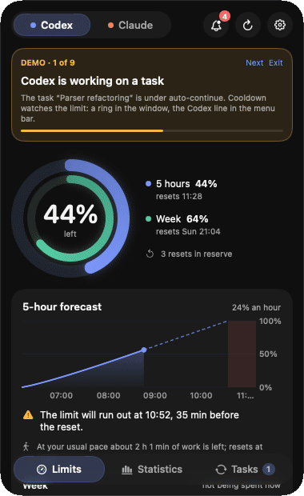
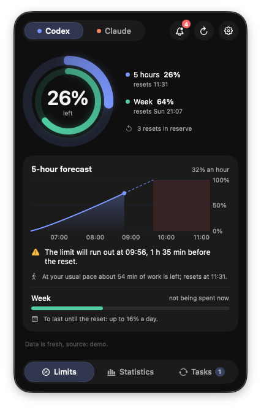
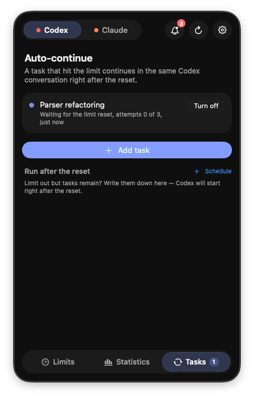
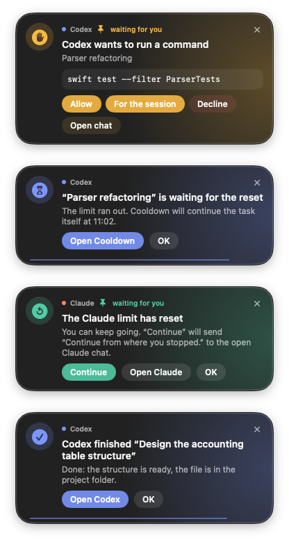
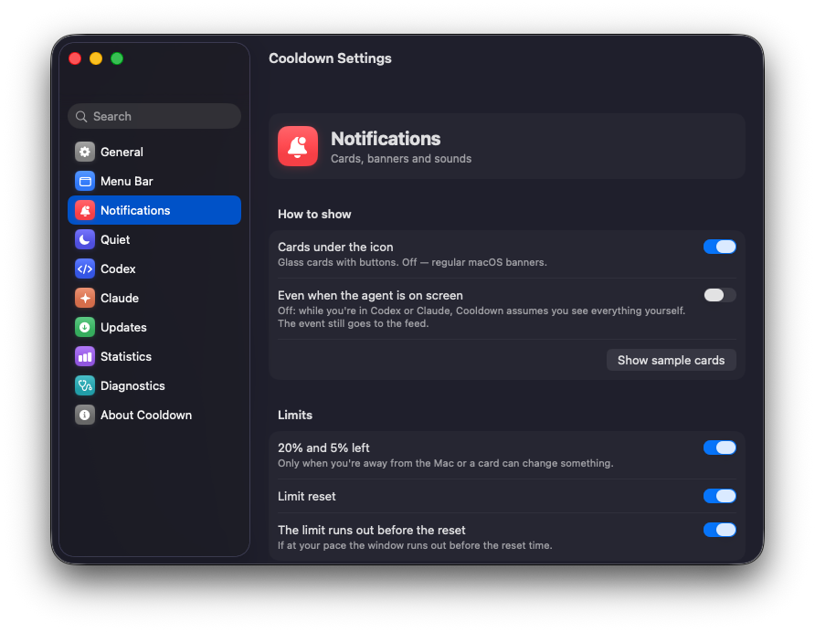

<p align="center"></p>

<h1 align="center">Cooldown</h1>

<p align="center"><b>English</b> · <a href="README.ru.md">Русский</a></p>

<p align="center"><b>Your Codex and Claude limits in the macOS menu bar — and work that carries on by itself after a limit resets.</b></p>

<p align="center">
  <a href="https://github.com/vitalyor/cooldown/releases/latest"></a>
  <a href="https://github.com/vitalyor/cooldown/releases"></a>
  
  
  <a href="LICENSE"></a>
</p>

Ran out of limit in the middle of a task at night? Cooldown waits for the reset and continues the same
Codex conversation on its own, so in the morning the task is done. It also shows how much of the
5-hour and weekly limits is left, what each agent is doing, and brings permission requests to a card
you can answer from any app. Everything runs locally on your Mac; nothing is ever approved for you.

<p align="center"></p>

## Install

**Homebrew** (recommended):

```sh
brew install --cask vitalyor/tap/cooldown
```

**Or download** the latest [Cooldown-x.y.z.dmg](https://github.com/vitalyor/cooldown/releases/latest),
open it and drag Cooldown to Applications.

<details>
<summary>macOS says it “can't verify the developer” — what to do</summary>

Cooldown is free and open source, but it isn't notarized by Apple (that needs a paid developer account).
So the first time you open the downloaded app, macOS stops it:

1. Open Cooldown once and close the warning.
2. Go to **System Settings → Privacy & Security**, scroll down and press **Open Anyway**.
3. Confirm with your password. From then on Cooldown opens normally and updates itself.

Or in Terminal: `xattr -dr com.apple.quarantine /Applications/Cooldown.app`.
Homebrew does this for you. Every release lists SHA-256 checksums, and the app checks the checksum
and signature of each update before installing it.
</details>

**Testers welcome.** Found a bug or have an idea? [Open an issue](https://github.com/vitalyor/cooldown/issues/new/choose)
(the diagnostics report in Settings makes it quick) or say hi in [Discussions](https://github.com/vitalyor/cooldown/discussions).

> Unofficial project, not affiliated with OpenAI or Anthropic. Codex and Claude are trademarks of their owners.

<table>
  <tr>
    <td align="center"><br><sub>Limits and a forecast</sub></td>
    <td align="center"><br><sub>Auto-continue after the reset</sub></td>
    <td align="center"><br><sub>Cards you can answer</sub></td>
  </tr>
</table>

## Features

**Limits**
- The 5-hour and weekly limits of Codex and Claude in the menu bar: a number and a bar coloured by what is left.
- Forecast: when the limit runs out at the current pace, whether it lasts until the reset, how much you can spend per day.
- Comparison with your usual pace and with previous weeks.
- When a limit runs out: when you can work again, a reminder 10 minutes before the reset, a Codex task queued for the reset moment.

**What the agents are doing**
- While an agent works, a soft light runs along its bar in the menu bar; an orange dot means it is waiting for your decision.
- Cards under the menu bar icon: "finished" (with the start of the answer, time spent and share of the limit),
  "waiting for your decision", "limit is back", "silent for 15 minutes", "stopped with an error".
- Answer requests right on the card: permissions and questions from Codex, Claude Code and Claude chats,
  including multi-question requests, step by step. Cooldown never approves anything for you.
- Sources: Codex session files, Codex and Claude Code hooks (optional), the Claude Desktop window
  via Accessibility.

**Continuing after a reset**
- Codex: a task that hit the limit continues by itself, right after the limit resets (built in, nothing else to install).
- Claude Code: a session continues by itself via `claude --resume`.
- Claude Desktop chats: Cooldown finds the chat and sends the continuation — only when you press the button.
- Deferred Codex tasks: start as soon as Codex has limit again.

**Statistics**
- Tokens, projects, models and the approximate API price of the same work.
- "Year of work" — a day-by-day grid, like on GitHub.
- The most expensive tasks, tasks per project, what an average task costs on each model.
- A weekly summary, also as a picture you can save or share; CSV export.

**Settings and diagnostics**
- A separate settings window with sections and search.
- Diagnostics: one button checks every link (apps, limits, hooks, the Claude window, notifications, updates)
  and gives a report you can copy — without your paths or personal data.
- Updates from GitHub with checksum and signature checks.

<p align="center"></p>

**Languages**
- English, Русский, Українська, Deutsch, Français, Español, Português (Brasil), Italiano, 日本語, 简体中文, 한국어.
  The app follows the macOS language; you can pick another one for Cooldown in
  System Settings → General → Language & Region → Applications.

## Requirements

- macOS 26 (Tahoe) or later.
- To build from source: Command Line Tools (`xcode-select --install`); Xcode is not required.
- Codex and/or Claude Code / Claude Desktop — whichever you use.

## Build and run

```sh
./build.sh            # build build/Cooldown.app
./build.sh --install  # build, copy to /Applications and launch
```

Optional but handy — a stable local signing identity, so macOS keeps the permissions it granted
across builds:

```sh
scripts/make_signing_identity.sh
```

Building your own version next to the original? Give it its own bundle id so settings and
permissions don't mix: `echo 'COOLDOWN_BUNDLE_ID=com.yourname.cooldown' > local.env`.

## First launch

Cooldown shows what is missing in its Settings window (⌘, or the gear) → General → Readiness:
- **Notifications** — for cards when you are away from the Mac.
- **Accessibility** — to see that Claude Desktop is writing an answer, and to continue chats.
- **Agent hooks** (optional) — instant events from Codex and Claude Code. Codex asks once to
  approve the new hooks.

## Privacy

Cooldown sends nothing to servers of its own — there are none. Details: [docs/PRIVACY.md](docs/PRIVACY.md).

## How it works

[docs/ARCHITECTURE.md](docs/ARCHITECTURE.md) — data sources, modules, and how Cooldown keeps its
resource use low. Ideas behind the features: [IDEAS.md](IDEAS.md).

## Thanks

- [Codex Auto Resume](https://github.com/progressrdx/codex-auto-resume) by progressrdx showed that
  continuing Codex after a limit reset can be done safely. Since version 1.3 Cooldown's auto-continue is
  its own implementation, written from a specification without that project's code
  ([docs/clean-room](docs/clean-room)).

## License

[MIT](LICENSE).
