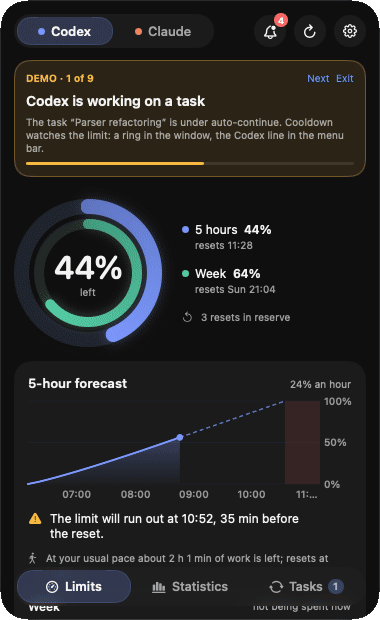
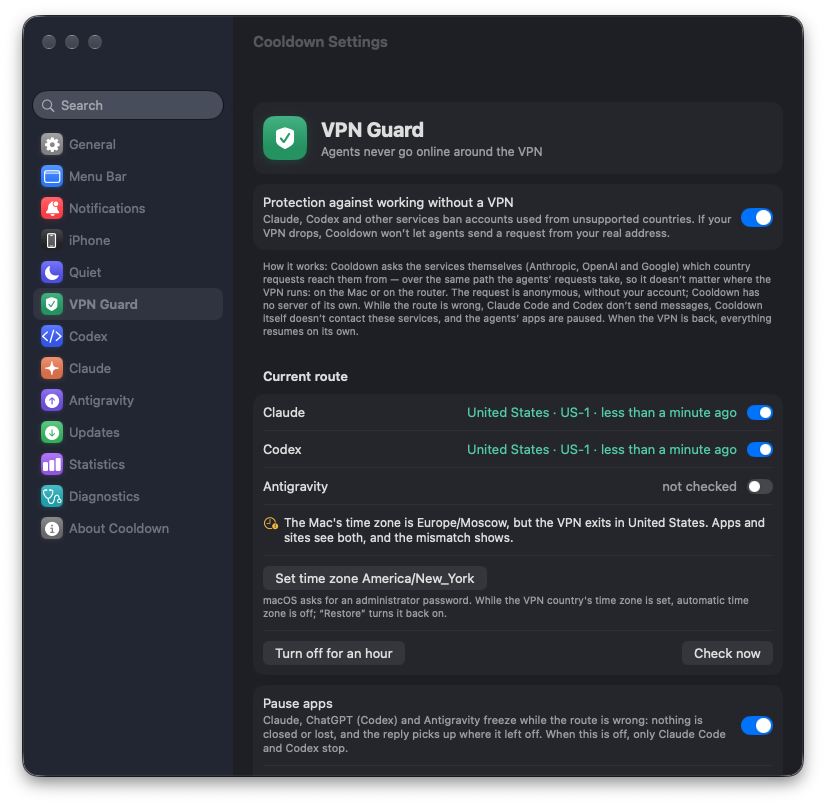
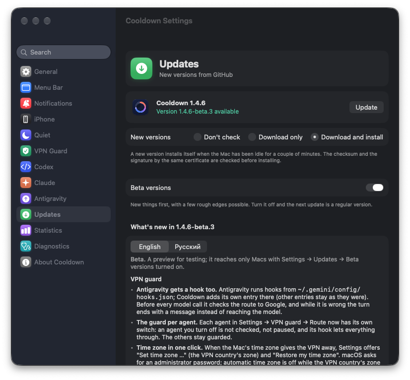

<p align="center"></p>

<h1 align="center">Cooldown</h1>

<p align="center"><b>English</b> · <a href="README.ru.md">Русский</a></p>

<p align="center"><b>Your Codex, Claude and Antigravity limits in the macOS menu bar — work that continues by itself after the reset, and agents that never go online around your VPN.</b></p>

<p align="center">
  <a href="https://github.com/vitalyor/cooldown/releases/latest"></a>
  <a href="https://github.com/vitalyor/cooldown/releases"></a>
  
  
  <a href="LICENSE"></a>
</p>

Ran out of limit in the middle of a task at night? Cooldown waits for the reset and continues the same
Codex conversation on its own, so in the morning the task is done. It also shows how much of the
5-hour and weekly limits is left, what each agent is doing, and brings permission requests to a card
you can answer from any app. If your VPN drops, it stops the agents before a single request leaves
from your real address. Monitoring and task control run locally on your Mac; nothing is ever
approved for you. The optional iPhone connection uses a relay and Apple push notifications.

<p align="center"></p>

## Install

**Homebrew** (recommended):

```sh
brew install --cask vitalyor/tap/cooldown
```

**Or download** the latest [Cooldown-x.y.z.dmg](https://github.com/vitalyor/cooldown/releases/latest),
open it and drag Cooldown to Applications.

Cooldown is signed with a Developer ID certificate and notarized by Apple, so it opens like any other Mac app.

**Testers welcome.** Found a bug or have an idea? [Open an issue](https://github.com/vitalyor/cooldown/issues/new/choose)
(the diagnostics report in Settings makes it quick) or say hi in [Discussions](https://github.com/vitalyor/cooldown/discussions).

> Unofficial project, not affiliated with OpenAI, Anthropic or Google. Codex, Claude and Antigravity are trademarks of their owners.

<table>
  <tr>
    <td align="center"><br><sub>Limits and a forecast</sub></td>
    <td align="center"><br><sub>Auto-continue after the reset</sub></td>
    <td align="center"><br><sub>Cards you can answer, here and on the iPhone</sub></td>
  </tr>
</table>

## Features

**Limits**
- The 5-hour and weekly limits of Codex, Claude and Google Antigravity in the menu bar: a number and a bar coloured by what is left.
  Pick which one or two agents get a line; agents you don't use can be hidden and brought back in Settings.
- Forecast: when the limit runs out at the current pace, whether it lasts until the reset, how much you can spend per day.
- Comparison with your usual pace and with previous weeks.
- When a limit runs out: when you can work again (the weekly reset when the week is spent), a reminder 10 minutes
  before the reset, a Codex task queued for the reset moment.
- A friendly word under the forecast, different for each window: night owl, almost out, plenty left.

**What the agents are doing**
- While an agent works, a soft light runs along its bar in the menu bar; an orange dot means it is waiting for your decision.
- Cards under the menu bar icon: "finished" (with the start of the answer, time spent and share of the limit),
  "waiting for your decision", "limit is back", "silent for 15 minutes", "stopped with an error".
- Answer requests right on the card: permissions and questions from Codex (including app access for
  Computer Use), Claude Code and Claude chats,
  including multi-question requests, step by step. Cooldown never approves anything for you.
- Sources: Codex session files, Codex and Claude Code hooks (optional), the Claude Desktop window
  via Accessibility.

**Continuing after a reset**
- Codex: a task that hit the limit continues by itself, right after the limit resets (built in, nothing else to install).
- Claude Code: the session continues by itself through `claude --resume`.
- Claude Desktop chats: the chats you picked (or the one the limit stopped) continue after the reset — automatically
  if you turned that on, otherwise with one press on the card. Only a chat the limit really stopped is continued;
  Cooldown presses Claude's own "Try again" when it is there.
- Deferred Codex tasks: start as soon as Codex has limit again.
- While a task waits for the reset, its bar in the menu bar turns into the time left until it continues.

**When an agent gets stuck**
- If Codex stops answering Cooldown, a card says so right away instead of pretending an answer went out.
- Restart Codex or Claude from that card or from the iPhone (Face ID), or let Cooldown do it by itself
  when the link breaks (a setting): never while something
  is running there (a turn, a request, a question, unsent text) — then it waits until the agent is free.
  It quits the app the normal way (like ⌘Q), never kills it, starts it again in the background and checks
  that Cooldown sees it again. Each restart is written to the event feed.

**VPN guard** (off by default)

AI services ban accounts used from countries they don't serve, and a VPN drops now and then: sleep,
a new Wi-Fi, a router switching servers. The guard asks the services themselves which country they see,
along the very route the agents' requests take — so it works whether the VPN runs on the Mac, on the
router or only for some sites.
- Checks each service where its agents talk to it: `api.anthropic.com` and `claude.ai`, `chatgpt.com` and
  `api.openai.com` (Cloudflare's own answer), and Google's view for Antigravity. IPv4 and IPv6 apart, and
  through the system proxy if one is set. Anonymous: no account, no cookie, no server of Cooldown's own.
- Notices a VPN blink the moment it happens (the system's routing messages and proxy settings), and pauses
  the agents' apps until the route is checked again — usually under a second, unnoticed if nothing changed.
  The same on waking from sleep.
- While a route is wrong: hooks in Claude Code, Codex and Antigravity hold your message and stop work between
  steps; Claude, ChatGPT (Codex) and Antigravity are paused by the system (nothing is closed or lost, the
  answer goes on where it stopped); Cooldown makes no request of its own. Optionally, agents running in
  Terminal are paused too. When the route is right again, everything goes on by itself.
- A new exit address in an allowed country doesn't stop anything: a card asks to allow it once, remember it
  (with a name like "US-1") or block it.
- Per agent: switch the guard off for one agent and keep the others guarded. Or pause it all for an hour —
  it comes back by itself, even if Cooldown is closed.
- The Mac's time zone gives the VPN away? Cooldown says so and sets the VPN country's zone in one click
  (and puts yours back).
- If Cooldown itself crashes, paused apps go on within two seconds: the guard never leaves you stuck.

<p align="center"></p>

**On the iPhone** (optional)
- The same cards with their buttons: answer a permission request, continue a chat after the reset, allow a
  new VPN exit, check the route again, turn the guard back on, update Cooldown on the Mac.
- Face ID for anything that lets work go on or speaks for you: "Allow", a typed answer, pausing the guard,
  restarting an agent, updating.
- A Live Activity with the limits and the countdown to the reset; end-to-end encryption between the Mac and
  the phone. How it works: [docs/LINK.md](docs/LINK.md).

**Statistics**
- Tokens, projects, models and the approximate API price of the same work.
- "Year of work" — a day-by-day grid, like on GitHub.
- The most expensive tasks, tasks per project, what an average task costs on each model.
- A weekly summary, also as a picture you can save or share; CSV export.

**Settings and diagnostics**
- A separate settings window with sections and search.
- Diagnostics: one button checks every link (apps, limits, hooks, the Claude window, notifications, updates)
  and gives a report you can copy — without your paths or personal data.
- Updates from GitHub with checksum and signature checks; "What's new" in the app's language. Beta versions
  for those who want new things first (Settings → Updates → Beta versions); everyone else gets only stable ones.

<p align="center"></p>

**Languages**
- English, Русский, Українська, Deutsch, Français, Español, Português (Brasil), Italiano, 日本語, 简体中文, 한국어.
  The app follows the macOS language; you can pick another one for Cooldown in
  System Settings → General → Language & Region → Applications.

## Requirements

- macOS 26 (Tahoe) or later.
- To build from source: Command Line Tools (`xcode-select --install`); Xcode is not required.
- Codex, Claude Code / Claude Desktop and/or Google Antigravity — whichever you use.

## Build and run

```sh
./build.sh            # build build/Cooldown.app
./build.sh --install  # build, copy to /Applications and launch
```

Optional but handy — a stable local signing identity, so macOS keeps the permissions it granted
across builds:

```sh
scripts/make_signing_identity.sh
```

The app icon is an Icon Composer document, `Resources/AppIcon.icon`: flat layers that macOS and iOS
render as Liquid Glass, with dark, tinted and clear looks. `scripts/make_icon.py` writes it, Icon Composer
(Xcode → Open Developer Tool) opens it for fine-tuning, and `scripts/icon-preview.sh` renders every look.
With Xcode installed, `build.sh` compiles it into the app; with only the Command Line Tools the app gets
the flat `Resources/AppIcon.icns` saved from the last such build.

Building your own version next to the original? Give it its own bundle id so settings and
permissions don't mix: `echo 'COOLDOWN_BUNDLE_ID=com.yourname.cooldown' > local.env`.

## First launch

Cooldown shows what is missing in its Settings window (⌘, or the gear) → General → Readiness:
- **Notifications** — for cards when you are away from the Mac.
- **Accessibility** — to see what Claude Desktop is writing.
- **Agent hooks** (optional) — instant events from Codex and Claude Code. Codex asks once to
  approve the new hooks.
- **VPN guard** (optional) — Settings → VPN guard. Turning it on adds its own hooks to Claude Code, Codex
  and Antigravity; turning it off removes them. Other tools' hooks stay as they were.

## Privacy

Cooldown has no analytics or telemetry. If you enable the iPhone connection, the Cooldown relay forwards encrypted messages and sends pushes through Apple. Live Activity
headings, button labels and countdowns are visible to the relay; chat titles, card text and commands
are encrypted. Cooldown also contacts GitHub for update checks unless you turn them off. With the VPN guard
on, it sends anonymous route checks to the AI services themselves (no account, no cookie).
Details: [docs/PRIVACY.md](docs/PRIVACY.md) and [docs/LINK.md](docs/LINK.md).

## How it works

[docs/ARCHITECTURE.md](docs/ARCHITECTURE.md) — data sources, modules, and how Cooldown keeps its
resource use low. Ideas behind the features: [IDEAS.md](IDEAS.md).

## License

[MIT](LICENSE).
