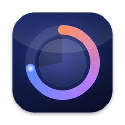
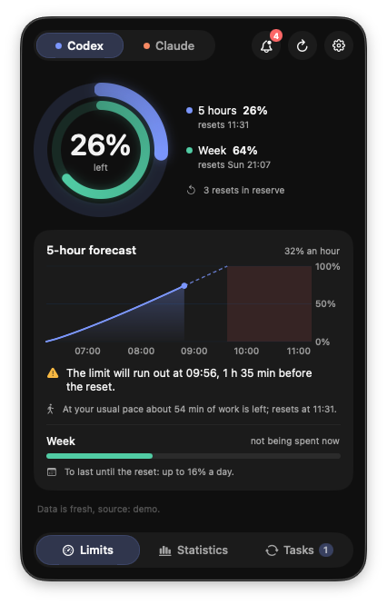
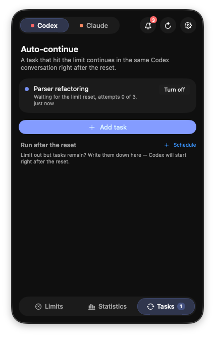
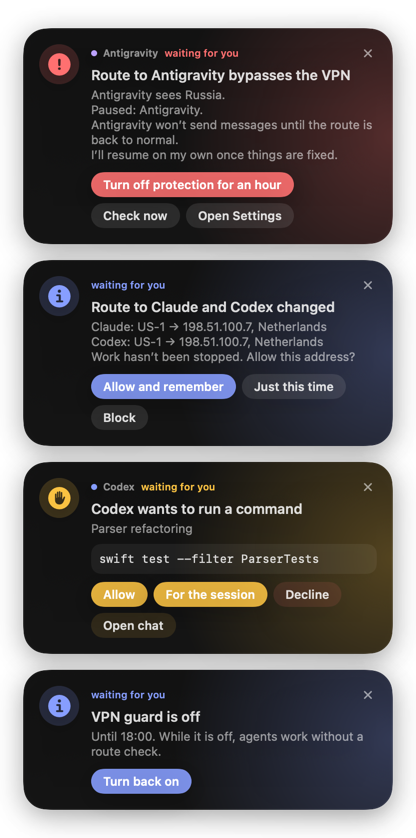
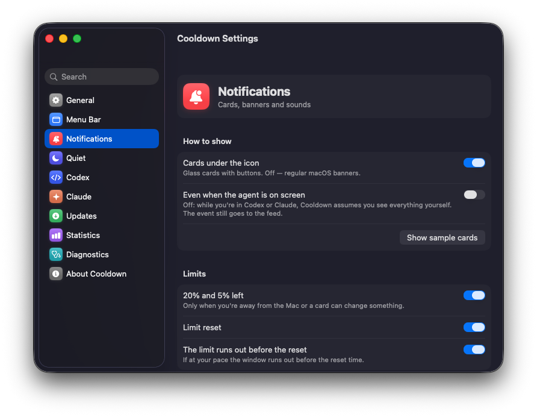

<p align="center"></p>

<h1 align="center">Cooldown</h1>

<p align="center"><b>English</b> · <a href="README.ru.md">Русский</a></p>

<p align="center"><b>Your Codex and Claude limits in the macOS menu bar — with cards that travel to your iPhone.</b></p>

<p align="center">
  <a href="https://github.com/vitalyor/cooldown/releases/latest"></a>
  <a href="https://github.com/vitalyor/cooldown/releases"></a>
  
  
  <a href="LICENSE"></a>
</p>

Ran out of limit in the middle of a task at night? Cooldown waits for the reset and continues the same
Codex conversation on its own, so in the morning the task is done. It also shows how much of the
5-hour and weekly limits is left, what each agent is doing, and brings permission requests to a card
you can answer from any app. Monitoring and task control run locally on your Mac; nothing is ever
approved for you. The optional iPhone connection uses a relay and Apple push notifications.

<p align="center"></p>

## Install

**Homebrew** (recommended):

```sh
brew install --cask vitalyor/tap/cooldown
```

**Or download** the latest [Cooldown-x.y.z.dmg](https://github.com/vitalyor/cooldown/releases/latest),
open it and drag Cooldown to Applications.

Cooldown is signed with a Developer ID certificate and notarized by Apple, so it opens like any other Mac app.

**Testers welcome.** Found a bug or have an idea? [Open an issue](https://github.com/vitalyor/cooldown/issues/new/choose)
(the diagnostics report in Settings makes it quick) or say hi in [Discussions](https://github.com/vitalyor/cooldown/discussions).

> Unofficial project, not affiliated with OpenAI or Anthropic. Codex and Claude are trademarks of their owners.

<table>
  <tr>
    <td align="center"><br><sub>Limits and a forecast</sub></td>
    <td align="center"><br><sub>Auto-continue after the reset</sub></td>
    <td align="center"><br><sub>Cards you can answer</sub></td>
  </tr>
</table>

## Features

**Limits**
- The 5-hour and weekly limits of Codex and Claude in the menu bar: a number and a bar coloured by what is left.
- Forecast: when the limit runs out at the current pace, whether it lasts until the reset, how much you can spend per day.
- Comparison with your usual pace and with previous weeks.
- When a limit runs out: when you can work again, a reminder 10 minutes before the reset, a Codex task queued for the reset moment.

**What the agents are doing**
- While an agent works, a soft light runs along its bar in the menu bar; an orange dot means it is waiting for your decision.
- Cards under the menu bar icon: "finished" (with the start of the answer, time spent and share of the limit),
  "waiting for your decision", "limit is back", "silent for 15 minutes", "stopped with an error".
- Answer requests right on the card: permissions and questions from Codex (including app access for
  Computer Use), Claude Code and Claude chats,
  including multi-question requests, step by step. Cooldown never approves anything for you.
- Sources: Codex session files, Codex and Claude Code hooks (optional), the Claude Desktop window
  via Accessibility.

**Continuing after a reset**
- Codex: a task that hit the limit continues by itself, right after the limit resets (built in, nothing else to install).
- Claude Code: the session continues by itself through `claude --resume`.
- Claude Desktop chats: the chats you picked (or the one the limit stopped) continue after the reset — automatically
  if you turned that on, otherwise with one press on the card. Only a chat the limit really stopped is continued;
  Cooldown presses Claude's own "Try again" when it is there.
- Deferred Codex tasks: start as soon as Codex has limit again.
- While a task waits for the reset, its bar in the menu bar turns into the time left until it continues.

**When an agent gets stuck**
- If Codex stops answering Cooldown, a card says so right away instead of pretending an answer went out.
- Restart Codex or Claude from that card or from the iPhone (Face ID), or let Cooldown do it by itself
  when the link breaks (a setting): never while something
  is running there (a turn, a request, a question, unsent text) — then it waits until the agent is free.
  It quits the app the normal way (like ⌘Q), never kills it, starts it again in the background and checks
  that Cooldown sees it again. Each restart is written to the event feed.

**Statistics**
- Tokens, projects, models and the approximate API price of the same work.
- "Year of work" — a day-by-day grid, like on GitHub.
- The most expensive tasks, tasks per project, what an average task costs on each model.
- A weekly summary, also as a picture you can save or share; CSV export.

**Settings and diagnostics**
- A separate settings window with sections and search.
- Diagnostics: one button checks every link (apps, limits, hooks, the Claude window, notifications, updates)
  and gives a report you can copy — without your paths or personal data.
- Updates from GitHub with checksum and signature checks.

<p align="center"></p>

**Languages**
- English, Русский, Українська, Deutsch, Français, Español, Português (Brasil), Italiano, 日本語, 简体中文, 한국어.
  The app follows the macOS language; you can pick another one for Cooldown in
  System Settings → General → Language & Region → Applications.

## Requirements

- macOS 26 (Tahoe) or later.
- To build from source: Command Line Tools (`xcode-select --install`); Xcode is not required.
- Codex and/or Claude Code / Claude Desktop — whichever you use.

## Build and run

```sh
./build.sh            # build build/Cooldown.app
./build.sh --install  # build, copy to /Applications and launch
```

Optional but handy — a stable local signing identity, so macOS keeps the permissions it granted
across builds:

```sh
scripts/make_signing_identity.sh
```

Building your own version next to the original? Give it its own bundle id so settings and
permissions don't mix: `echo 'COOLDOWN_BUNDLE_ID=com.yourname.cooldown' > local.env`.

## First launch

Cooldown shows what is missing in its Settings window (⌘, or the gear) → General → Readiness:
- **Notifications** — for cards when you are away from the Mac.
- **Accessibility** — to see what Claude Desktop is writing.
- **Agent hooks** (optional) — instant events from Codex and Claude Code. Codex asks once to
  approve the new hooks.

## Privacy

Cooldown has no analytics or telemetry. If you enable the iPhone connection, a relay (by default
`cooldown.nolim.cloud`) forwards encrypted messages and sends pushes through Apple. Live Activity
headings, button labels and countdowns are visible to the relay; chat titles, card text and commands
are encrypted. Cooldown also contacts GitHub for update checks unless you turn them off.
Details: [docs/PRIVACY.md](docs/PRIVACY.md) and [docs/LINK.md](docs/LINK.md).

## How it works

[docs/ARCHITECTURE.md](docs/ARCHITECTURE.md) — data sources, modules, and how Cooldown keeps its
resource use low. Ideas behind the features: [IDEAS.md](IDEAS.md).

## License

[MIT](LICENSE).
