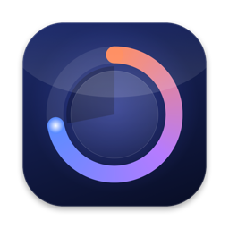
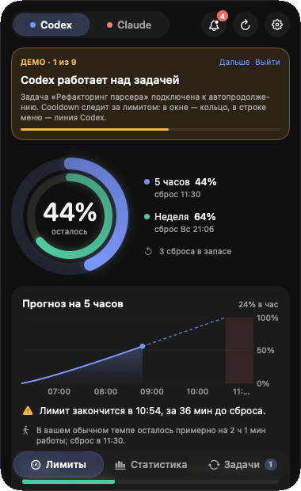
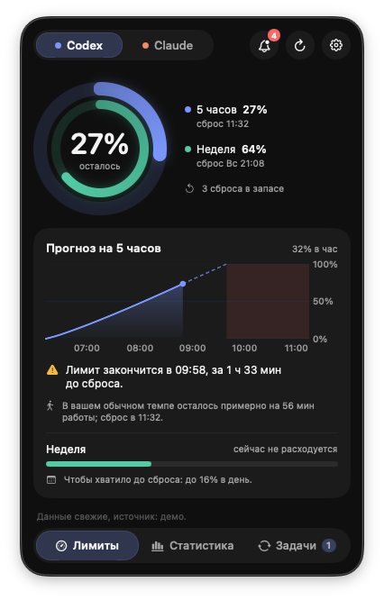
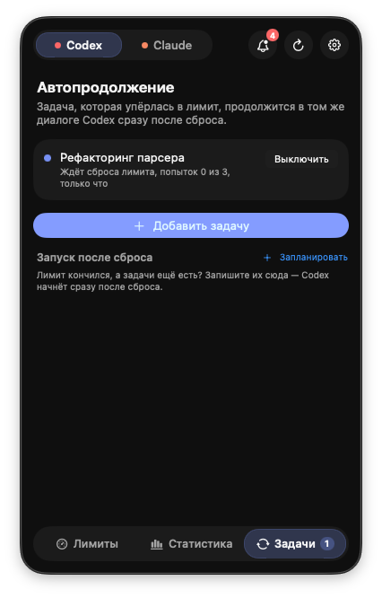
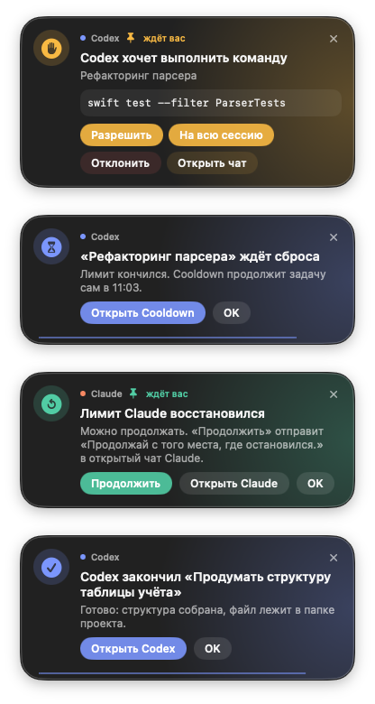
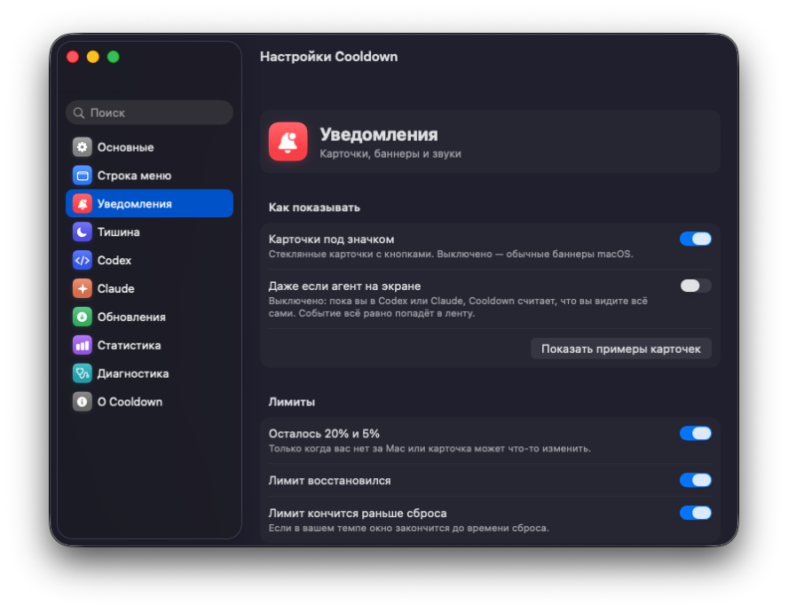

<p align="center"></p>

<h1 align="center">Cooldown</h1>

<p align="center"><a href="README.md">English</a> · <b>Русский</b></p>

<p align="center"><b>Лимиты Codex и Claude в строке меню macOS — и работа, которая сама продолжается после сброса лимита.</b></p>

<p align="center">
  <a href="https://github.com/vitalyor/cooldown/releases/latest"></a>
  <a href="https://github.com/vitalyor/cooldown/releases"></a>
  
  
  <a href="LICENSE"></a>
</p>

Лимит кончился посреди задачи ночью? Cooldown дождётся сброса и сам продолжит тот же диалог Codex —
утром задача готова. А ещё он показывает, сколько осталось от 5-часового и недельного лимита, что
делает каждый агент, и приносит запросы разрешений в карточку, на которую можно ответить из любого
приложения. Всё работает локально, на вашем Mac; ничего не одобряется за вас.

<p align="center"></p>

## Установка

**Через Homebrew** (удобнее всего):

```sh
brew install --cask vitalyor/tap/cooldown
```

**Или скачайте** последний [Cooldown-x.y.z.dmg](https://github.com/vitalyor/cooldown/releases/latest),
откройте и перетащите Cooldown в «Программы».

<details>
<summary>macOS пишет, что «не удаётся проверить разработчика», — что делать</summary>

Cooldown бесплатный и с открытым кодом, но не заверен Apple (для этого нужен платный аккаунт разработчика).
Поэтому при первом открытии скачанного приложения macOS его остановит:

1. Откройте Cooldown один раз и закройте предупреждение.
2. Зайдите в **Системные настройки → Конфиденциальность и безопасность**, пролистайте вниз и нажмите **Всё равно открыть**.
3. Подтвердите паролем. Дальше Cooldown открывается как обычно и обновляется сам.

Или в Терминале: `xattr -dr com.apple.quarantine /Applications/Cooldown.app`.
Homebrew делает это сам. В каждом релизе есть контрольные суммы SHA-256, а каждое обновление
приложение перед установкой проверяет по контрольной сумме и подписи.
</details>

**Нужны тестировщики.** Нашли ошибку или есть идея? [Создайте issue](https://github.com/vitalyor/cooldown/issues/new/choose)
(отчёт диагностики из настроек сильно ускоряет дело) или напишите в [Discussions](https://github.com/vitalyor/cooldown/discussions).

> Неофициальный проект. Не связан с OpenAI или Anthropic. Названия Codex и Claude принадлежат их владельцам.

<table>
  <tr>
    <td align="center"><br><sub>Лимиты и прогноз</sub></td>
    <td align="center"><br><sub>Автопродолжение после сброса</sub></td>
    <td align="center"><br><sub>Карточки с ответами</sub></td>
  </tr>
</table>

## Что умеет

**Лимиты**
- 5-часовой и недельный лимит Codex и Claude в строке меню: число и линия, цвет — по остатку.
- Прогноз: когда кончится лимит при текущем темпе, хватит ли до сброса, сколько можно тратить в день.
- Сравнение с вашим обычным темпом и с прошлыми неделями.
- Когда лимит кончился: когда снова можно работать, напоминание за 10 минут до сброса, задача Codex на момент сброса.

**Что делают агенты**
- Пока агент работает, по его линии в строке меню пробегает мягкий свет; оранжевая точка — ждёт вашего решения.
- Карточки под значком: «закончил» (с началом ответа, временем и долей лимита), «ждёт решения»,
  «лимит восстановился», «молчит 15 минут», «остановился с ошибкой».
- Ответ на запросы прямо на карточке: разрешения и вопросы Codex, Claude Code и чатов Claude,
  в том числе запросы из нескольких вопросов — по шагам. Cooldown ничего не одобряет за вас.
- Источники: файлы сессий Codex, хуки Codex и Claude Code (по желанию), окно Claude Desktop
  через «Универсальный доступ».

**Продолжение после сброса**
- Codex: задача, упёршаяся в лимит, продолжается сама сразу после сброса лимита (встроено, ничего ставить не нужно).
- Claude Code: сессия продолжается сама через `claude --resume`.
- Чаты Claude Desktop: Cooldown находит нужный чат и отправляет продолжение — только по вашему нажатию.
- Отложенные задачи Codex: запускаются, как только у Codex снова есть лимит.

**Статистика**
- Токены, проекты, модели и примерная цена той же работы по API.
- «Год работы» — сетка по дням, как на GitHub.
- Самые дорогие задачи, задачи по проектам, сколько в среднем стоит задача на каждой модели.
- Итоги недели, в том числе картинкой, которую можно сохранить или отправить; выгрузка в CSV.

**Настройки и диагностика**
- Отдельное окно настроек с разделами и поиском.
- Диагностика: одна кнопка проверяет каждое звено (приложения, лимиты, хуки, окно Claude, уведомления, обновления)
  и даёт отчёт, который можно скопировать, — без ваших путей и личных данных.
- Обновления с GitHub с проверкой контрольной суммы и подписи.

<p align="center"></p>

**Языки**
- English, Русский, Українська, Deutsch, Français, Español, Português (Brasil), Italiano, 日本語, 简体中文, 한국어.
  Приложение следует языку macOS; отдельный язык для Cooldown можно выбрать в
  «Системные настройки → Основные → Язык и регион → Приложения».

## Требования

- macOS 26 (Tahoe) или новее.
- Для сборки из исходников: Command Line Tools (`xcode-select --install`); Xcode не нужен.
- Codex и/или Claude Code / Claude Desktop — то, что вы используете.

## Сборка и запуск

```sh
./build.sh            # собрать build/Cooldown.app
./build.sh --install  # собрать, положить в /Applications и запустить
```

Необязательно, но удобно — постоянная локальная подпись, чтобы macOS не забывала выданные
разрешения после каждой сборки:

```sh
scripts/make_signing_identity.sh
```

Собираете свою версию рядом с оригиналом? Задайте ей свой идентификатор, чтобы настройки и
разрешения не смешивались: `echo 'COOLDOWN_BUNDLE_ID=com.yourname.cooldown' > local.env`.

## Первый запуск

Cooldown сам подскажет в окне настроек (⌘, или шестерёнка) → «Основные» → «Готовность», чего не хватает:
- **Уведомления** — для карточек, когда вас нет за Mac.
- **Универсальный доступ** — чтобы видеть, что Claude Desktop пишет ответ, и продолжать чаты.
- **Хуки агентов** (по желанию) — мгновенные события от Codex и Claude Code. Codex попросит один раз
  разрешить новые хуки.

## Приватность

Cooldown ничего не отправляет на свои серверы — их нет. Подробно: [docs/PRIVACY.ru.md](docs/PRIVACY.ru.md).

## Как устроено

[docs/ARCHITECTURE.ru.md](docs/ARCHITECTURE.ru.md) — источники данных, модули, как Cooldown экономит ресурсы.
Идеи, с которых начинались функции: [IDEAS.ru.md](IDEAS.ru.md).

## Лицензия

[MIT](LICENSE).
